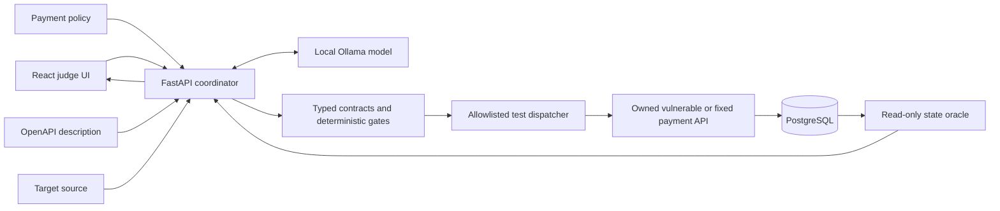

# AuthFlow-Defense

**AuthFlow-Defense is a local cybersecurity prototype that checks whether a payment workflow settles the terms that were approved.** It connects requirements spread across a policy, API description, and application source; proposes a bounded test; runs that test against an owned vulnerable or fixed application; and verifies the outcome from PostgreSQL state.

This is a controlled lab demonstration, not a production security product or a general-purpose vulnerability scanner.

## What it demonstrates

The included policy describes approval, amendment, and settlement behavior in separate sections. The prototype proposes an invariant that joins those sections, maps the relevant application routes and state transitions, and plans a create → approve → edit → execute workflow.

- In **vulnerable** mode, an approved payment can be amended while retaining its approved status. The live target then settles the changed terms.
- In **fixed** mode, amending an approved payment returns it to pending. The settlement attempt is rejected.
- A read-only database oracle compares the terms recorded at approval with the actual ledger entry. The verdict comes from persisted state, not an LLM's assertion.

The judge UI displays the run stages, proposed invariant and plan, actual HTTP requests and responses, and database-backed verdict.

## Architecture



The model roles have distinct tasks: policy analysis, evidence audit, application mapping, test planning, and plan critique. They use the same local model in this MVP, so they are **not statistically independent**. LLM output is treated as an untrusted proposal. Typed schemas, exact-source evidence checks, payment-specific premise checks, bounded action validation, and the database oracle provide deterministic controls. The model critic is advisory.

## Repository layout

| Path | Purpose |
|---|---|
| `backend/app/` | FastAPI API, agent calls, schemas, orchestration, validation, execution, and oracle |
| `target/app/` | Deliberately vulnerable/fixed payment API used as the authorized demo target |
| `frontend/src/` | React judge UI |
| `fixtures/` | Payment policy and OpenAPI fixture analyzed by the prototype |
| `infra/init.sql` | PostgreSQL roles and database permissions |
| `compose.yaml` | Local Docker Compose deployment |
| `start-demo.ps1` | Windows startup checks and Compose launcher |
| `start-local-demo.ps1` | Launcher for a preconfigured Windows host-run environment |
| `docs/IMPLEMENTATION_PLAN.md` | Module boundaries, execution sequence, trust boundaries, and implementation status |

## Requirements

The recommended path uses:

- Docker Desktop with Docker Compose (and WSL 2 on Windows)
- [Ollama](https://ollama.com/) running on the host
- The `qwen2.5:3b-instruct` model (about 1.9 GB); see the [Ollama model page](https://ollama.com/library/qwen2.5%3A3b-instruct) for model details and terms

The Compose configuration binds the UI and API to loopback on the host. The demo target is not published as a host port; Compose places it on an internal lab network. PostgreSQL is also not published to the host.

## Quick start with Docker Compose

Clone the repository, then from the project directory:

```powershell
Copy-Item .env.example .env
ollama pull qwen2.5:3b-instruct
.\start-demo.ps1
```

`start-demo.ps1` checks Docker and Ollama, pulls the configured model if needed, and starts the Compose stack. On other shells, start Ollama, pull the model, then run:

```bash
cp .env.example .env
ollama pull qwen2.5:3b-instruct
docker compose up --build
```

Open **http://localhost:5173**. The UI health panel should show the API/database, target, and configured Ollama model as available.

To stop the Compose stack while preserving its database volume:

```bash
docker compose down
```

Use `docker compose down -v` only when you intentionally want to delete the persisted database volume.

## Run the live demo

1. In the UI, choose **Vulnerable** or **Fixed**.
2. Select **Run live analysis**.
3. Inspect the proposed policy invariant, evidence, mapped workflow, bounded test plan, critique, HTTP trace, and final database-backed result.
4. Compare the vulnerable and fixed outcomes.

Expected results:

| Mode | Settlement request | Oracle result |
|---|---|---|
| Vulnerable | Accepted after the approved payment is amended | `PROVEN`: ledger terms differ from the approval snapshot |
| Fixed | Rejected after the approved payment is amended | `NOT_REPRODUCED`: no ledger entry for that run |

The API is also available at **http://localhost:8000**. Health check: `GET /api/health`. Interactive API docs: **http://localhost:8000/docs**.

## Windows host-run fallback

`start-local-demo.ps1` runs the target, API, and frontend directly on Windows. It is intended for a **preconfigured development checkout**: it expects a Python virtual environment at `.venv`, frontend dependencies under `frontend/node_modules`, PostgreSQL binaries under `.tools/postgresql-16.15/pgsql`, and an initialized database cluster under `.local/pgdata`. Those local directories are ignored by Git and are not created by this script. For a fresh clone, use the Docker Compose setup unless you have provisioned those dependencies yourself.

On a prepared machine:

```powershell
.\start-local-demo.ps1
.\start-local-demo.ps1 -Action status
.\start-local-demo.ps1 -Action stop
```

Host-run services bind to `127.0.0.1`. The stop action only stops processes recorded by the script when their process identity still matches; it does not reset or delete database contents.

## Configuration

Settings can be changed in `.env`. The checked-in `.env.example` contains **demo-only local credentials** for the Compose lab. Do not reuse them outside the isolated demo, expose the lab services to a public network, or point the vulnerable target at production systems. `.env` is excluded from Git.

Useful settings include:

| Variable | Default | Purpose |
|---|---|---|
| `OLLAMA_MODEL` | `qwen2.5:3b-instruct` | Local model used by the agent roles |
| `APP_MODE` | `vulnerable` | Initial target behavior |
| `OLLAMA_BASE_URL` | `http://host.docker.internal:11434` | Ollama address from the API container |

## Scope and limitations

- The MVP uses the included payment policy, OpenAPI description, and target source. User uploads and arbitrary application onboarding are not implemented.
- The supported workflow is limited to create, approve, edit, and execute actions, with a fixture-specific payment invariant and oracle.
- The deterministic policy-premise gate is specific to this payment example; it is not a general natural-language policy engine.
- Agent roles share one model. Role separation assigns different jobs but does not eliminate correlated errors.
- The critic and model evidence-auditor decisions can disagree with deterministic checks; their outputs are retained as advisory evidence and do not independently authorize execution.
- This demo does not establish that AI discovers a non-obvious business-logic flaw better than an experienced tester or a purpose-written script.
- No production payment rail, production target, or external system is supported.

See [`docs/IMPLEMENTATION_PLAN.md`](docs/IMPLEMENTATION_PLAN.md) for the detailed module plan, execution sequence, trust boundaries, and known verification status.

## License

No license file is currently included. Add a license before granting users permission to reuse or redistribute this project.
